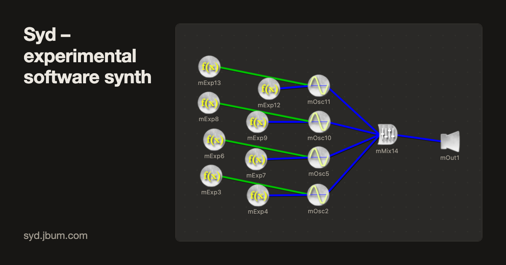

# Syd

Syd is an instrument editor and software synthesizer by Jim Bumgardner, first written in 1997 in C++.
Sounds are built from units wired together with patch cords (oscillators, envelopes, filters, mixers,
delays, samples, plucked strings) and played by scores, and almost every setting can be an expression.
It is particularly suitable for teaching computer music.

**Try it in your browser: [syd.jbum.com](https://syd.jbum.com/)**, a patch editor that renders with CSyd
compiled to WebAssembly, on your own computer. Its [About page](https://syd.jbum.com/about.html) tells
the project's history.

## What's here

| Directory | What |
|---|---|
| `csyd_200/` | **CSyd 2.0** (2026): the command-line renderer, made several times faster and multi-threaded, with its own math library so every platform renders the same bits; its WebAssembly build and the browser editor (`web/`). |
| `csyd_152/` | CSyd 1.5.2: 1.5.1 with its bugs fixed (64-bit builds, stereo headers, run-to-run differences) and nothing else changed. See its `CHANGES.md`. The reference 2.0 is tested against. |
| `csyd_102/` | CSyd 1.5.1 as it was, and most of the example patches (`patches/`). |
| `jsyd_102/` | JSyd (2006–2011), the Java patch editor. |

### Building CSyd 2.0

    cd csyd_200 && make
    ./csyd -o shepard.wav ../csyd_102/patches/shepard.syd    # no arguments: the options

New options over 1.5: `-j` threads, `-b` block size, `-r` random seed,
`-M` maximum seconds, `-P` progress. The browser version is built with Emscripten
(`build/build_wasm.sh web`, then `build/build_web.py`).

### Tests

`csyd_200/tests/` grades every corpus patch against 1.5.2 (`compare.py`), checks that the WebAssembly
build renders byte-identical to the native one (`compare_wasm.py`), and that the editor's reader and
writer round-trip every patch (`roundtrip.js`).

## Uses of Syd

The most notable use of Syd is the [Whitney Music Box](https://whitneymusicbox.org/). Syd was used for
all the variations using harmonics and non-standard tunings, for example
[v0](https://whitneymusicbox.org/index.php?var=v0), [v2](https://whitneymusicbox.org/index.php?var=v2),
[v6](https://whitneymusicbox.org/index.php?var=v6), [v7](https://whitneymusicbox.org/index.php?var=v7) and
[v16](https://whitneymusicbox.org/index.php?var=v16). The patch used to render the Whitney Music Box is
quite elegant in Syd, making use of its unusual method of generating polyphony with a single "score unit".
The video [Behind the Whitney Music Box](https://youtu.be/iqGd_BRqyuE) talks about both.

Syd has also been used in introductory computer music classes at a few schools.

## History (major milestones only)

- **2026** CSyd 1.5.2 (bug fixes) and CSyd 2.0: faster, multi-threaded, identical output everywhere,
  WebAssembly, and a browser patch editor at [syd.jbum.com](https://syd.jbum.com/).
- **2011** JSyd and CSyd added to GitHub.
- **2009** Version 1.5.1: stereo and panning support in CSyd and JSyd.
- **2006** JSyd (Java version of Syd) created, originally to make Syd more cross-platform. CSyd (command
  line only version) created in conjunction with the Java version.
- **1998** Windows Syd 1.0.7 (C++, ported from Macintosh 1.0.6).
- **1997** Original version of Syd (written in C++ on the Macintosh).
